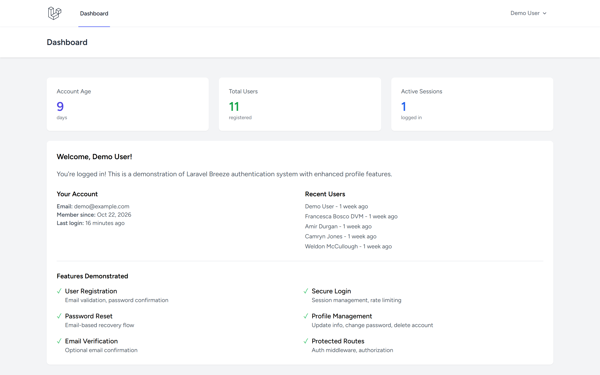
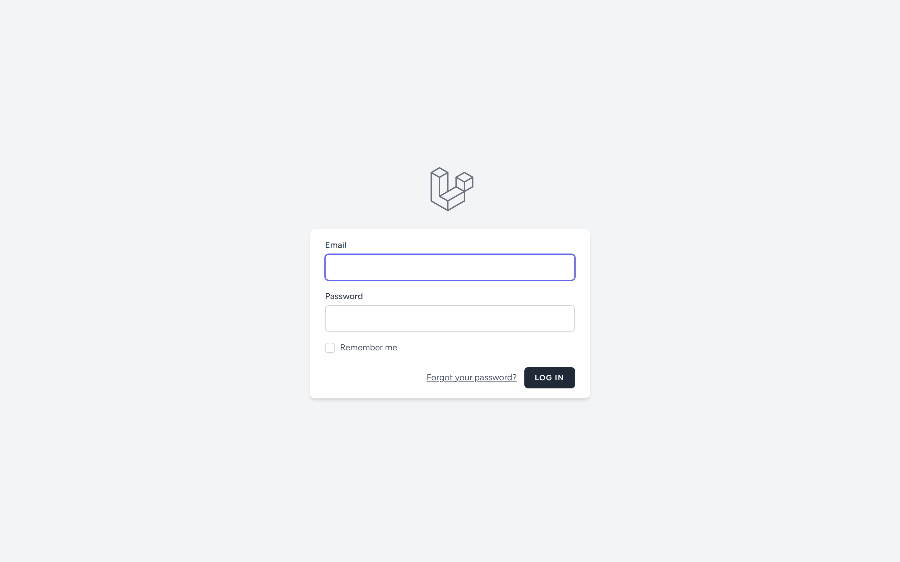
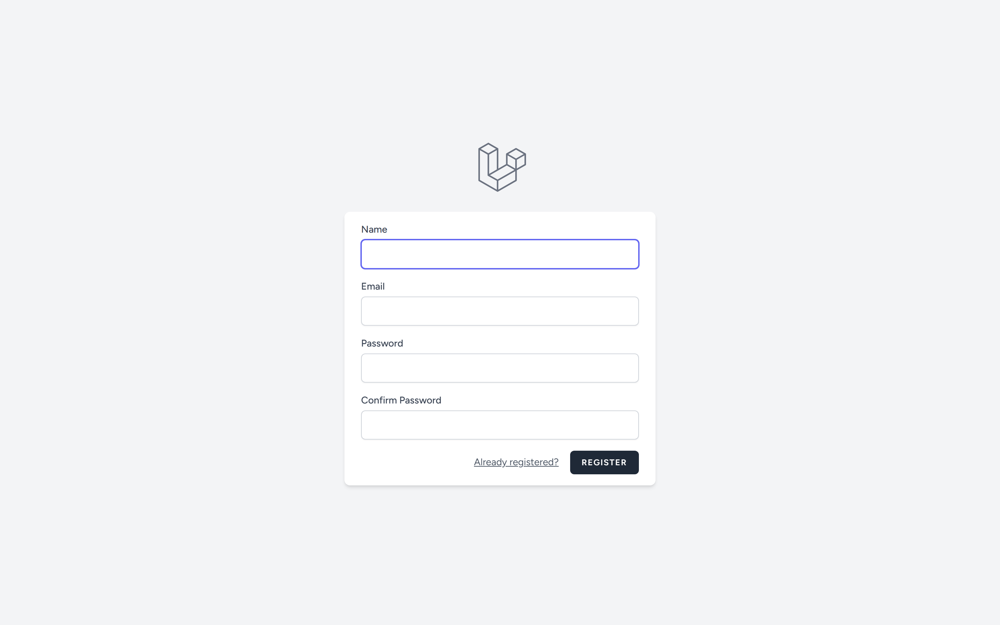
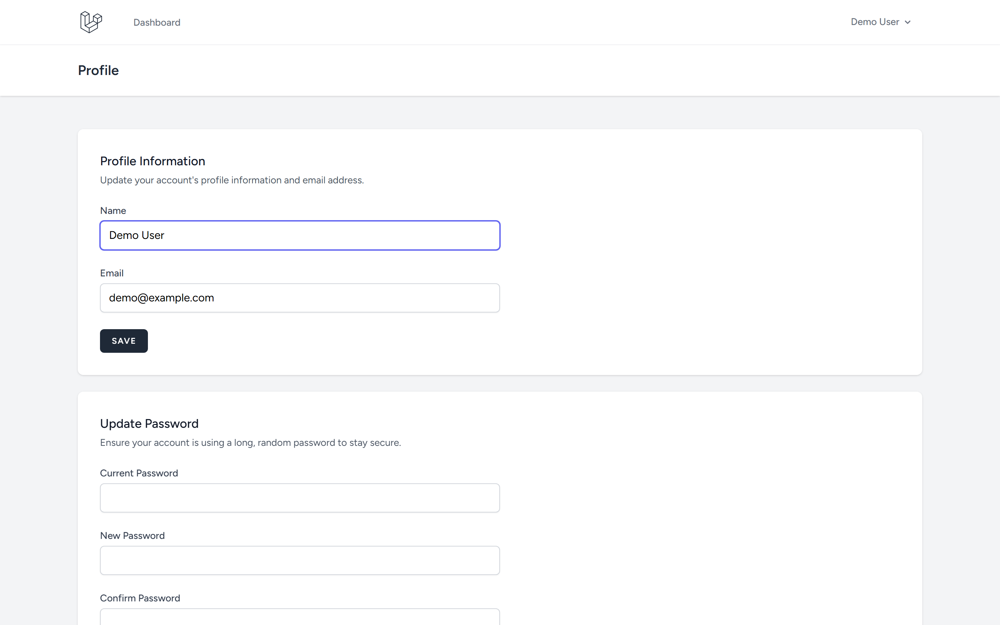

# Login & Register System - Laravel

Complete authentication system demonstration using Laravel Breeze with enhanced dashboard and user management.

Repository: https://github.com/0xyz-exe/login-register-system-laravel

## Screenshots

| Tampilan | Preview |
|---|---|
| **Dasbor Autentikasi & Metrik Akun**<br>Panel kontrol pengguna terautentikasi dengan metrik usia akun, total pengguna terdaftar, sesi aktif, dan daftar periksa fitur keamanan |  |
| **Portal Masuk Pengguna (Sign In)**<br>Antarmuka login aman dengan validasi email, kata sandi, opsi remember me, pemulihan kata sandi, dan proteksi rate limiting |  |
| **Portal Pendaftaran Akun Baru (Register)**<br>Formulir pendaftaran pengguna baru dengan verifikasi keunikan email, konfirmasi kata sandi, dan enkripsi hashing otomatis |  |
| **Pengaturan Profil & Keamanan Akun**<br>Pusat pengelolaan informasi profil pengguna, pembaruan kata sandi berkala, dan penghapusan akun mandiri secara permanen |  |

## Features

- ✅ User Registration with validation
- ✅ Secure Login with session management
- ✅ Password Reset via email
- ✅ Email Verification (optional)
- ✅ Profile Management (update info, change password)
- ✅ Account Deletion
- ✅ Protected Routes with middleware
- ✅ Rate Limiting on auth endpoints
- ✅ Enhanced Dashboard with user statistics
- ✅ CSRF Protection
- ✅ Password Hashing (bcrypt)

## Tech Stack

- Laravel 13.38.0
- Laravel Breeze 2.4
- PHP 8.5.0
- SQLite
- Tailwind CSS

## Installation

```bash
git clone https://github.com/0xyz-exe/login-register-system-laravel.git
cd login-register-system-laravel
composer install
npm install
cp .env.example .env
php artisan key:generate
touch database/database.sqlite
php artisan migrate --seed
npm run build
php artisan serve
```

## Demo Account

- Email: demo@example.com
- Password: password

## Features Detail

### Registration
- Name, email, password fields
- Password confirmation
- Email uniqueness validation
- Automatic login after registration

### Login
- Email and password authentication
- "Remember me" option
- Session regeneration for security
- Rate limiting (5 attempts per minute)

### Password Reset
- Email-based recovery
- Secure token generation
- Password confirmation
- Token expiration

### Profile Management
- Update name and email
- Change password
- Delete account with confirmation
- Profile data validation

### Dashboard
- User statistics
- Account age
- Total registered users
- Recent user list
- Feature overview

## Security

- CSRF tokens on all forms
- Password hashing with bcrypt
- Session regeneration on login
- Rate limiting on authentication
- SQL injection prevention
- XSS protection via Blade

## Database Schema

**users table:**
- id, name, email, email_verified_at
- phone, bio, avatar (profile fields)
- last_login_at
- password, remember_token
- created_at, updated_at

## Routes

- `/register` - Registration form
- `/login` - Login form
- `/forgot-password` - Password reset request
- `/reset-password` - Password reset form
- `/dashboard` - User dashboard (auth required)
- `/profile` - Profile management (auth required)

## Testing

```bash
php artisan test
```

## Repository

https://github.com/0xyz-exe/login-register-system-laravel
